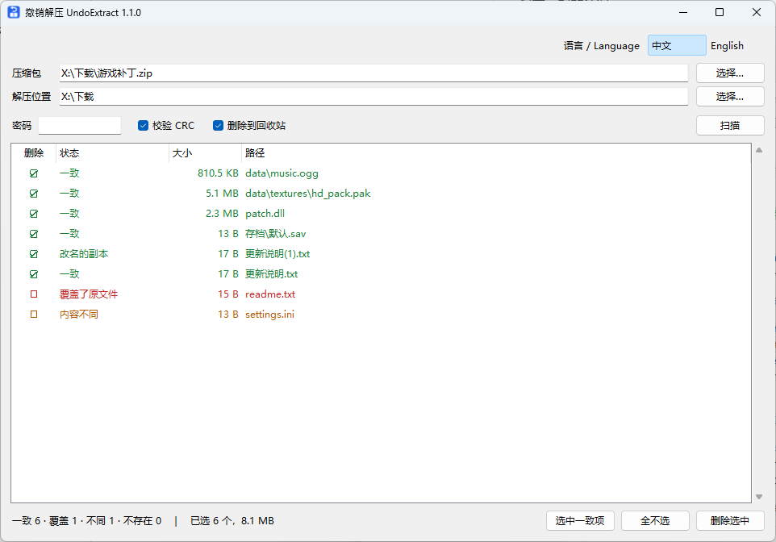
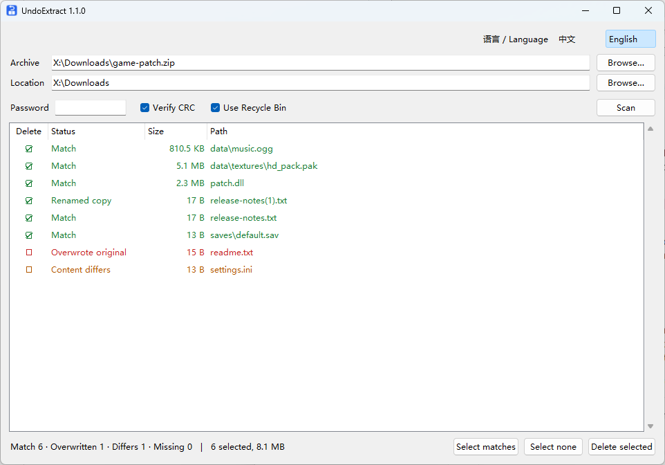

# 撤销解压 UndoExtract

[中文](#中文) | [English](#english)

## 中文

撤销解压：根据原压缩包，找出并删除这次解压出的文件。适用于误解压到当前文件夹或桌面、文件散落并和原有文件混在一起的情况。



### 功能

- 按完整路径比对，包括解压进已有同名文件夹的文件
- 比对大小和 CRC，内容一致的文件才默认选中
- 识别解压时被覆盖的原有文件（红色）
- 识别因重名被自动改名的副本（如 `a_1.txt`、`a(1).txt`）
- 删除到回收站，并移除变空的文件夹
- 支持 7-Zip 能打开的格式（zip、7z、rar、tar.gz 等），支持加密压缩包
- 中英文界面，右上角切换
- 单个 exe，内置 7-Zip，无需安装

### 使用

1. 从 [Releases](https://github.com/yimu-aiden/UndoExtract/releases/latest) 下载 `UndoExtract-*-win64.zip`，解压后运行 `UndoExtract.exe`，把压缩包拖进窗口。解压位置默认为压缩包所在文件夹。
2. 如果解压到了其他位置，把该文件夹拖进窗口，或点“选择…”。加密压缩包需填写密码后点“扫描”。
3. 检查列表，点“删除”列或按空格切换选中。
4. 点“删除选中”。

### 状态

| 状态 | 默认选中 | 说明 |
|---|---|---|
| 一致 | 是 | 大小和 CRC 与压缩包一致 |
| 一致（仅大小） | 是 | 压缩包无 CRC（如 tar），只比对了大小 |
| 改名的副本 | 是 | 解压时因重名被自动改名，内容与压缩包一致 |
| 覆盖了原文件 | 否 | 内容一致，但该位置原有同名文件被覆盖 |
| 大小不同 / 内容不同 / 时间不同 | 否 | 与压缩包不一致 |
| 不存在 | — | 文件夹中没有此文件 |

### 说明

- 被覆盖文件的原内容无法恢复，可尝试 右键 → 属性 → 以前的版本。
- 解压中途取消时，未写完的文件显示为“内容不同”或“大小不同”，需手动选中。
- 改名副本支持 `a_1.txt`（7-Zip）、`a(1).txt`（WinRAR）、`a (1).txt` 三种格式，需开启 CRC 校验。
- U 盘和网络位置没有回收站，删除即为永久删除。
- 覆盖识别仅适用于 NTFS 磁盘。
- exe 未签名，Windows 可能提示“已保护你的电脑”，点“更多信息 → 仍要运行”。

### 从源码运行 / 打包

需要 Windows 10/11 64 位、Python 3.10+、64 位 7-Zip。

```bash
pyw undo_extract.pyw
```

```bash
py build.py
```

打包结果在 `dist\UndoExtract.exe`。

### 许可

[MIT](LICENSE)。exe 内附带的 [7-Zip](https://www.7-zip.org) 以 GNU LGPL 授权（RAR 部分受 unRAR 许可限制），见 `7-Zip License.txt`。

---

## English

Undo an unzip: finds and deletes the files extracted from an archive, using the original archive. For when an archive was extracted into the wrong folder or the desktop and its files got mixed with yours.



### Features

- Matches by full path, including files extracted into existing folders
- Compares size and CRC; only matching files are selected by default
- Detects existing files that were overwritten by the extraction (red)
- Detects copies auto-renamed because of a name conflict (e.g. `a_1.txt`, `a(1).txt`)
- Deletes to the Recycle Bin and removes folders left empty
- Supports any format 7-Zip can open (zip, 7z, rar, tar.gz, …), including encrypted archives
- Chinese and English UI, switch in the top-right corner
- Single exe with 7-Zip bundled, no installation

### Usage

1. Download `UndoExtract-*-win64.zip` from [Releases](https://github.com/yimu-aiden/UndoExtract/releases/latest), extract it, run `UndoExtract.exe`, and drop the archive onto the window. Location defaults to the archive's folder.
2. If it was extracted elsewhere, drop that folder onto the window or click **Browse…**. For encrypted archives, enter the password and click **Scan**.
3. Review the list. Click the **Delete** column or press Space to toggle selection.
4. Click **Delete selected**.

### Statuses

| Status | Selected | Meaning |
|---|---|---|
| Match | Yes | Size and CRC match the archive |
| Match (size only) | Yes | The archive has no CRC (e.g. tar); only size was compared |
| Renamed copy | Yes | Auto-renamed during extraction because of a name conflict; contents match the archive |
| Overwrote original | No | Contents match, but an existing file at this path was overwritten |
| Size / Content / Time differs | No | Differs from the archive |
| Missing | — | Not in the folder |

### Notes

- Original contents of overwritten files can't be recovered; try right-click → Properties → Previous Versions.
- If extraction was cancelled, the unfinished file shows as Content differs or Size differs; select it manually.
- Renamed copies are detected in three formats: `a_1.txt` (7-Zip), `a(1).txt` (WinRAR) and `a (1).txt`. CRC checking must be on.
- USB drives and network locations have no Recycle Bin; deletion there is permanent.
- Overwrite detection works on NTFS only.
- The exe is unsigned. If Windows shows “Windows protected your PC”, click “More info → Run anyway”.

### Run from source / build

Requires 64-bit Windows 10/11, Python 3.10+, and 64-bit 7-Zip.

```bash
pyw undo_extract.pyw
```

```bash
py build.py
```

The exe is written to `dist\UndoExtract.exe`.

### License

[MIT](LICENSE). The bundled [7-Zip](https://www.7-zip.org) is licensed under the GNU LGPL (RAR code under the unRAR restriction); see `7-Zip License.txt`.
